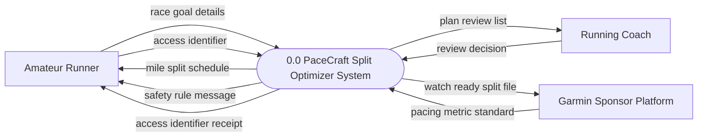
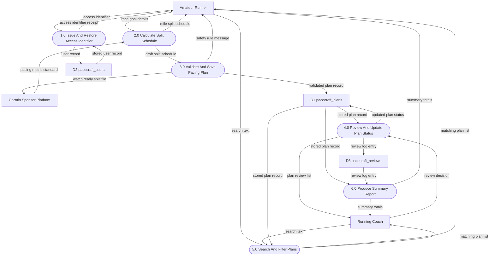
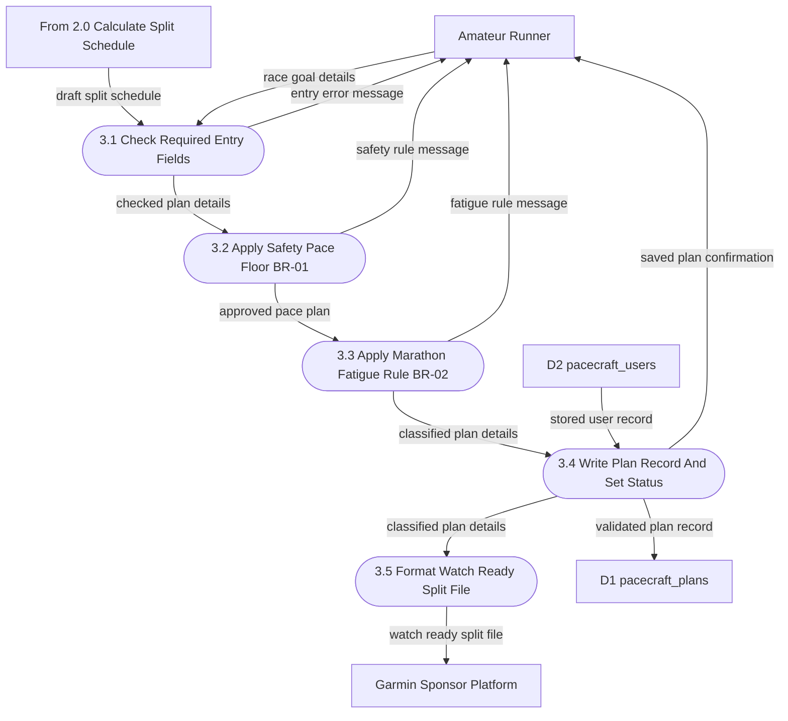
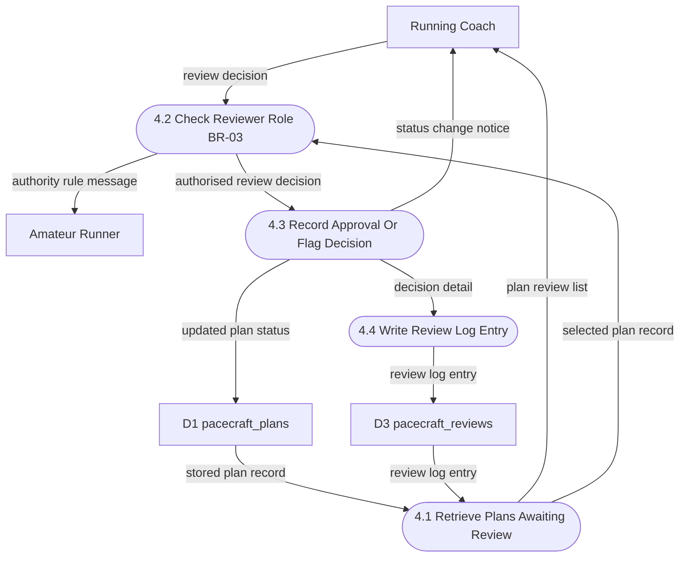
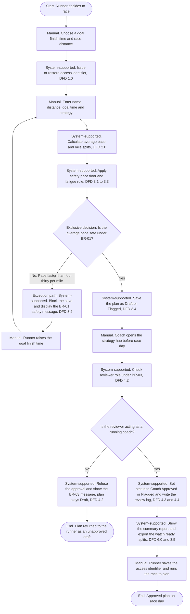

# PaceCraft: The Split Optimizer — System Diagrams

## 1. Context Diagram

## 2. Level-0 Data Flow Diagram

## 3. Level-1 Data Flow Diagram: Process 3.0 (Validate and Save Pacing Plan)

## 4. Level-1 Data Flow Diagram: Process 4.0 (Review and Update Plan Status)

## 5. Business Process Model: Create and Approve a Race Strategy

